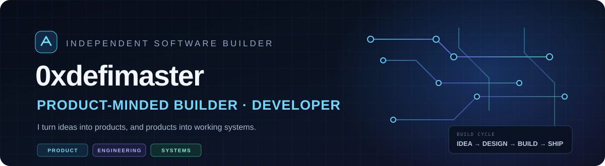
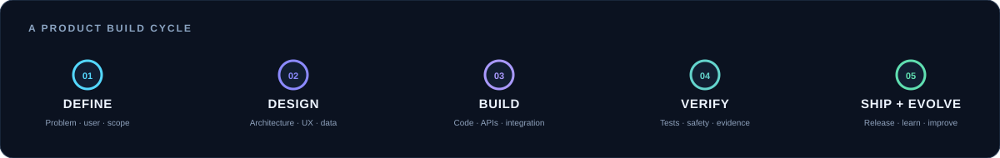
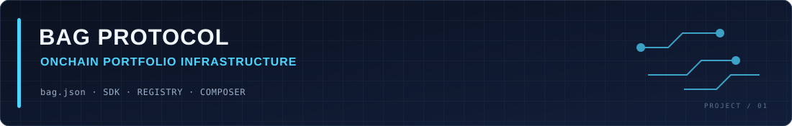
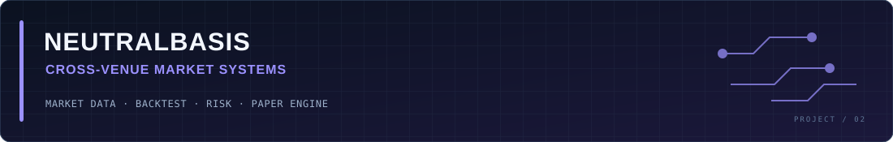
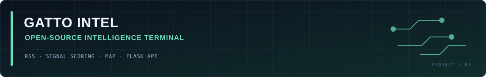
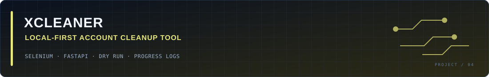
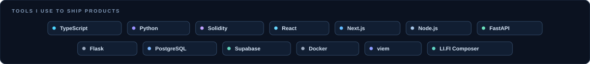

  

  <strong>PRODUCT-MINDED BUILDER · SOFTWARE DEVELOPER · SYSTEMS DESIGN</strong> 
  I turn ideas into products, and products into working systems — from architecture and core logic to interfaces, integrations, testing, and release.

  <a href="#selected-builds">SELECTED BUILDS</a> &nbsp; ◈ &nbsp;
  <a href="#how-i-build">HOW I BUILD</a> &nbsp; ◈ &nbsp;
  <a href="#the-road-ahead">THE ROAD AHEAD</a> &nbsp; ◈ &nbsp;
  <a href="#toolbox">TOOLBOX</a>

---

## I LIKE BUILDING THE WHOLE THING.

I enjoy taking a product from an early idea to a system people can actually use. That means thinking through the product, shaping its architecture, writing the code, connecting external services, building the interface, testing the important paths, and improving it after real usage.

I work across product and engineering. I care about **what should be built, why it should work, how the pieces fit together, and whether the result holds up outside a demo.**

  

## SELECTED BUILDS

These projects span different domains, but share the same approach: define a useful product, build the underlying system, and make its behavior verifiable.

### 01 / BAG Protocol
**Onchain Portfolio Strategy & Execution Infrastructure**

BAG is being built around a simple idea: an investment strategy should be a portable, verifiable object — not something locked inside one application. A creator defines a portfolio in `bag.json`; users can inspect it, verify its provenance, and execute it from their own wallets.

**What I have built**
- A versioned `bag.json` strategy format with deterministic validation, normalization, and hashing.
- Non-custodial strategy creation, deployment, purchase, sale, rebalance, versioning, and forks.
- Onchain strategy registry and verification, plus transaction-receipt-based execution records and accounting.
- LI.FI Composer integration for multi-asset execution, with explicit output and execution checks.
- A standalone TypeScript SDK and read-only MCP interface for developer access.

**Product direction — inspired by the BAG roadmap**

`STRATEGY STANDARD` → `VERIFIED EXECUTION` → `BEST EXECUTION` → `PORTFOLIO MANAGEMENT` → `EXECUTION INTELLIGENCE` → `AUTOMATION` → `OPEN STRATEGY NETWORK`

The foundation and selected execution flows are implemented and validated. Best-execution optimization, broader portfolio automation, and the open strategy ecosystem are ongoing roadmap directions — not claims of completed functionality.

[Repository](https://github.com/0xdefimaster/BagProtocolv2) · [Roadmap](https://github.com/0xdefimaster/BagProtocolv2/blob/main/docs/ROADMAP.md) · [Current status & evidence](https://github.com/0xdefimaster/BagProtocolv2/blob/main/docs/STATUS.md)

---

### 02 / Neutralbasis
**Cross-Venue Funding & Price-Convergence System**

Neutralbasis studies the relationship between perpetual markets across venues. It looks beyond a headline funding-rate difference and evaluates price dislocation, historical co-movement, order-book depth, fees, funding timing, and risk before a candidate can enter the paper engine.

**What I have built**
- A broad venue catalogue with public market-data adapters and explicit adapter/connectivity status.
- Funding normalization, cross-venue price comparisons, historical candle and funding collection.
- Spread, correlation, basis, order-book VWAP, and backtesting workflows.
- Funding-differential and price-convergence paper strategies with modeled costs, risk limits, and recovery behavior.
- Performance reporting that separates price PnL, funding, fees, and net result.

**Current boundary:** paper trading only. The system does not send live orders or move real collateral. A venue listed in the catalogue is not necessarily connected or supported for automatic execution.

[Repository](https://github.com/0xdefimaster/neutralbasis) · [Technical scope & limitations](https://github.com/0xdefimaster/neutralbasis/blob/main/NEUTRALBASIS-KAPSAM.md)

---

## OTHER BUILDS

### 03 / Gatto Intel
**OSINT & Geopolitical Monitoring Terminal**

Built before the Iran–US conflict escalation, Gatto Intel brings public reporting and open social signals into one monitoring interface. It combines news aggregation, signal scoring, a timeline, and a geospatial view so that developing events can be followed from one place.

- Aggregates public RSS feeds from international and regional news sources, with fallback sources for social-signal collection.
- Deduplicates similar reports and scores conflict-related keywords using a weighted heuristic model.
- Converts location and event terms into map markers and exposes news, signals, and map data through Flask API endpoints.
- Includes an optional scheduled publishing workflow that can use Gemini to rewrite high-scoring reports before posting through the X API.

**Note:** the conflict score is a heuristic indicator, not a calibrated probability or a war-prediction model. Some military-asset map entries are static historical OSINT records, not live positions.

[Repository](https://github.com/0xdefimaster/gatto-intel)

---

### 04 / XCleaner
**Local-First X Account Cleanup Utility**

XCleaner automates the repetitive task of deleting a user's own X posts and replies. It runs on the user's machine, opens a separate Chromium-based browser profile, and lets the account owner sign in directly — without handing the app their password or requiring an X developer API key.

- Shared Selenium core used by both a local FastAPI web interface and a CLI.
- Checks post ownership before attempting deletion and skips posts from other accounts.
- Dry-run mode, deletion limits, configurable delays, progress reporting, and stop control.
- Separate browser profile keeps the automation session apart from the user's everyday browser profile.

**Scope:** deletes posts and replies only; it does not remove likes or undo reposts. Deletion is permanent, so dry-run and confirmation safeguards are part of the product.

[Repository](https://github.com/0xdefimaster/xcleaner)

---

## HOW I BUILD

| Stage | What it means in practice |
|:--|:--|
| **01 · Product definition** | Understand the user, the problem, the workflow, and what a useful first version must do. |
| **02 · System design** | Define architecture, data models, interfaces, trust boundaries, and failure paths before adding complexity. |
| **03 · Implementation** | Build the product end-to-end: backend, frontend, APIs, integrations, automation, and developer tooling. |
| **04 · Verification** | Test core behavior, edge cases, transaction flows, data correctness, and recovery paths. Separate simulated results from live evidence. |
| **05 · Delivery & iteration** | Ship usable versions, observe how they behave, improve the weak points, and expand the roadmap deliberately. |

## THE ROAD AHEAD

My current direction is to keep moving from standalone applications toward reusable systems and infrastructure:

- **Product foundations:** clear domain models, dependable APIs, and developer-friendly interfaces.
- **Execution systems:** safer orchestration, provider abstraction, measurable outcomes, and recovery-aware workflows.
- **Intelligence layers:** turn raw data and observed behavior into context that helps users make better decisions.
- **Automation:** make repeatable workflows programmable without hiding control or risk from the user.
- **Open ecosystems:** build components other products, developers, and agents can integrate with.

The aim is not to chase every new tool. It is to build products that are useful today and structured to become more capable tomorrow.

## TOOLBOX

  

I use AI and automation as part of the build process when they make the product better or the work more effective. They are tools in the workflow — **the focus stays on product thinking, engineering, and execution.**

---

  <strong>THINK IT THROUGH. BUILD IT PROPERLY. MAKE IT WORK.</strong> 
  Product thinking × Engineering × Continuous building

  <a href="https://github.com/0xdefimaster/BagProtocolv2">BAG Protocol</a> &nbsp;·&nbsp;
  <a href="https://github.com/0xdefimaster/neutralbasis">Neutralbasis</a> &nbsp;·&nbsp;
  <a href="https://github.com/0xdefimaster/gatto-intel">Gatto Intel</a> &nbsp;·&nbsp;
  <a href="https://github.com/0xdefimaster/xcleaner">XCleaner</a>

